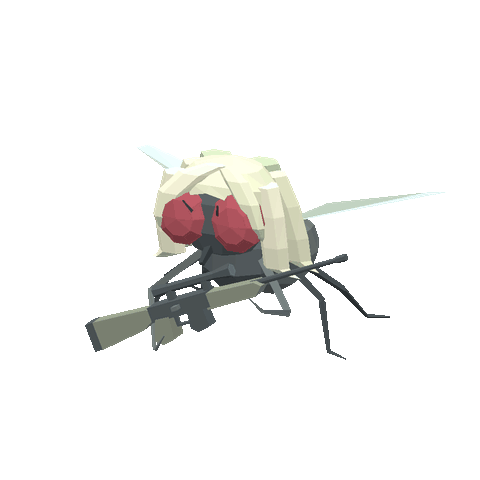
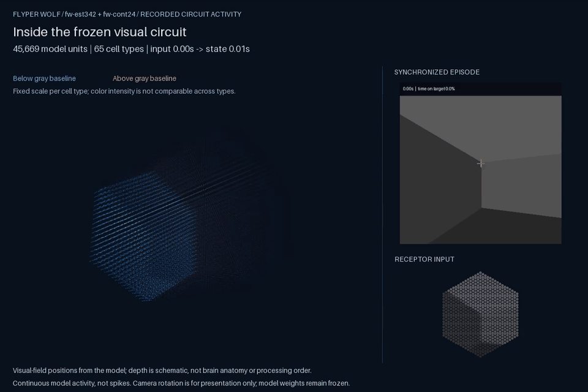
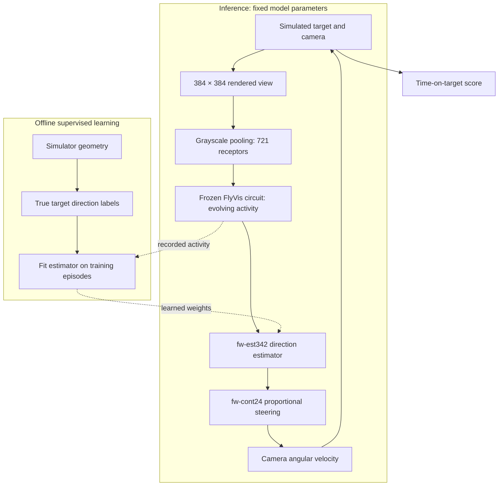
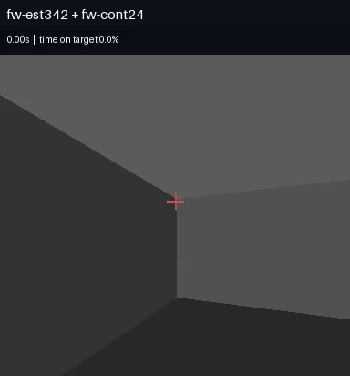
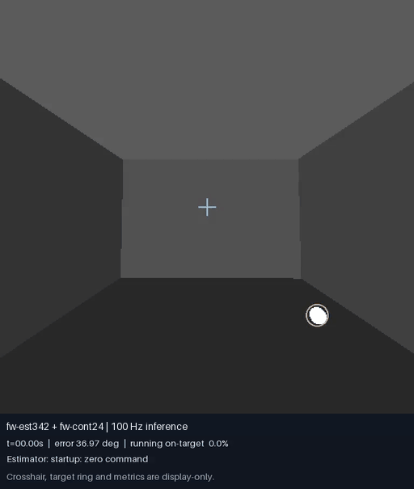
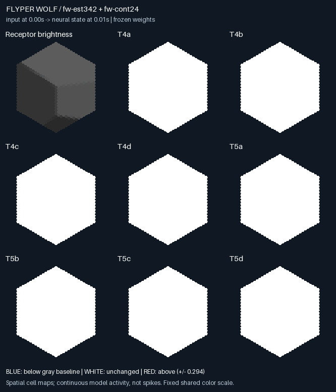

<p align="center">
  
</p>

<h1 align="center">Flyper Wolf</h1>

<p align="center">
  <a href="#running-locally"></a>
  <a href="https://pytorch.org/"></a>
  <a href="https://github.com/TuragaLab/flyvis"></a>
  <a href="https://huggingface.co/mospira/fw-est/tree/0563ee0400b30a34a729cbf742978a7beb1a6f87/fw-est342"></a>
  <a href="LICENSE"></a>
</p>

<p align="center">
  
</p>

The task is to keep a camera aimed at a moving bright sphere. The camera can turn in yaw and pitch but cannot move through the room. The system must infer where to aim from visual-circuit activity, rather than reading the target's position from the simulator.

The question I'm trying to explore is whether a fixed biologically grounded visual representation can actually provide enough information for a small learned decoder to guide tracking.

## Architecture and methodology

The camera's actions change what it sees next. This feedback makes tracking a **closed-loop** task since direction estimates should remain useful after the controller moves the camera.



**Visual circuit.** A fixed grayscale transform averages 11 × 11 pixel neighborhoods at 721 hexagonally arranged receptors. FlyVis 1.2.0's pretrained `flow/0000/000` model processes these inputs. Its parameters stay frozen, while neural activity evolves across time. Each 10 ms observation advances the circuit through two 5 ms steps; reset includes one second of neutral-gray adaptation.

**Direction estimator.** fw-est342 is a multilayer perceptron (MLP), a feedforward neural network that reads 24,514 ordered output-cell activities. Two 512-unit hidden layers predict a three-component camera-local direction: right, forward, and up. Stored feature normalization and cell ordering are reused at inference. Although the estimator reads current activity, that activity already carries the circuit's history.

**Controller.** fw-cont24 converts predicted direction into yaw and pitch errors, multiplies each by 24 per second, and clips each turn rate to ±60°/s. It has no learned weights, filters, offsets, or deadbands. The first 20 observations use zero camera action; afterward, observations, predictions, and actions run at 100 Hz. Circuit state resets between episodes.

The estimator receives circuit activity; the controller receives its predicted direction. Neither receives raw images, true target state, camera pose, seeds, future observations, or score. Simulator geometry supplies training labels and evaluation truth outside inference. Display overlays are added afterward.

<p align="center">
  
</p>

<p align="center"><em>fw-est342 + fw-cont24: ten-second example at normal speed, 87.13% time on target. Target/camera seeds: 302000001/303000001.</em></p>

<p align="center">
  
</p>

<p align="center"><em>fw-est342 + fw-cont24: continuous sixty-second episode shown at 4× speed, 96.811667% time on target. Target/camera seeds: 304000001/305000001. One reset and one continuous episode. Its scenario differs from the ten-second example, so their scores do not isolate duration's effect.</em></p>

<p align="center">
  
</p>

<p align="center"><em>Actual receptor input and T4/T5 activity from the ten-second fw-est342 + fw-cont24 episode. Blue/red show decreases/increases from the circuit's gray-adapted reset state, with one fixed shared scale across the eight cell types. These are continuous model values (not spikes). Input at time t produces the neural state at t + 10 ms. The GIF displays 10 frames/s; inference and archival recording remain at 100 Hz.</em></p>

An MP4 exporter renders all model units as a rotating 3D point cloud alongside the episode video and receptor input. Visual-field coordinates come from the model; depth separates cell types schematically and does not represent brain anatomy or processing order. Its fixed per-type color scales reveal changes within each type so intensity should not be compared between types. The commands below regenerate these visualizations without a browser.

**Task and score.** Both examples use a 12 × 16 × 8 room, camera at `(0, -6, 4)`, 90° horizontal field of view, sphere radius 0.288, and `smooth-reactive-plane-v1` motion at speed multiplier 1.1. Pitch is limited to ±80°. Time on target is **100 × contact time / full episode duration**, including startup. Contact means the camera's forward ray intersects the sphere. Scoring samples ten midpoints per 10 ms action interval (1 ms resolution), accounting for movement between observations rather than counting video frames.

**Learning and selection.** fw-est342 continued from estimator 315. Frozen 315 + fw-cont24 generated 1,000 ten-second training episodes and 64 separate validation episodes, saving circuit activity at 100 Hz. Supervised learning fitted predictions to true camera-local target directions. Training changed only the estimator; validation selected its checkpoint. fw-cont24 was retained as a simple research reference after controller comparisons, rather than established as optimal for every estimator.

Complete episodes are split between training and validation because nearby ticks are strongly related. Validation guides model selection; final-test episodes remain outside tuning. A **saved-view** evaluation feeds estimators the same recorded activity. A **closed-loop** evaluation lets each estimator steer its own camera and change future inputs. Better saved-view accuracy needs the latter check before it establishes better tracking.

<details>
<summary>Estimator fitting recipe and model identity</summary>

The final continuation phase used 980,000 eligible training rows per epoch (ticks 20–999), preserving 315's feature transform and starting fresh AdamW optimizer state. It minimized normalized-cosine loss: direction disagreement after removing vector magnitude. Hidden layers use ReLU, which clips negative activations to zero. Dropout temporarily omits activations during training and is disabled during inference.

| Setting | Value |
| --- | --- |
| Hidden sizes / dropout | `[512, 512]` / 0.1664114783 |
| Learning rate / weight decay | 0.0007179028 / 0.0000042325 |
| Batch size / gradient clipping | 128 / 5 |
| Selection | Lowest mean episode angular error on 64 validation episodes; earlier epoch wins ties |
| Stopping | Ten epochs without a 0.01° meaningful improvement |

Additional epoch 27 (lineage total 342) supplied the selected weights; fitting stopped at additional epoch 28 (total 343). Smaller improvements could update the best checkpoint without resetting stopping patience. An epoch reuses the same corpus, not independent new episodes. This phase used one training seed.

Estimator checkpoint SHA256: `858eaff1cbc17bf021fd66dec0509491da007f322a7471930dd83926c5d771d5`.

Output-cell order SHA256: `75d0bf0199b362498b9ac440db5986fa408caad7a6a63ac3bf639c93714d1b2c`.

The portable bundle binds these files, the feature transform, architecture, and frozen FlyVis checkpoint/network metadata by hash. The runner performs no fitting. The earlier direct-activity PPO controller is a separate architecture, not this estimator + fw-cont24 system.

</details>

## Current results

The current estimator improved direction decoding on its saved validation views, and the complete system has the two recorded tracking examples above. These answer different questions:

| Measurement for fw-est342 + fw-cont24 | Result | Evidence scope |
| --- | ---: | --- |
| Mean episode estimator bearing error | **0.249331°** | 64 saved validation episodes generated by 315 + fw-cont24; used for checkpoint selection |
| Ten-second tracking example | **87.13%** time on target | One closed-loop scenario; first hit 1.010 s; mean aiming error 3.997447° |
| Continuous minute example | **96.811667%** time on target | One closed-loop scenario; first hit 0.739 s; mean aiming error 1.090365° |

On the same saved views, initialization 315 scored 1.195592° and final epoch 343 scored 0.257250°. fw-est342 reduced that mean error by 79.15%; its episode means ranged from 0.128643° to 0.812589° (median 0.197808°). See [retained result provenance](docs/evidence/README.md#saved-view-validation).

<details>
<summary>Earlier matched tracking comparison: 277 versus 315</summary>

An earlier preliminary comparison let both estimators control their own cameras with fw-cont24 on 16 fresh matched ten-second scenarios (32 episodes). This supplies context for the approach, not a benchmark for fw-est342.

| Measure | 277 + fw-cont24 | 315 + fw-cont24 |
| --- | ---: | ---: |
| Mean time on target | 58.679375% | 82.758125% |
| Median time on target | 60.020% | 84.965% |
| Minimum time on target | 11.35% | 57.48% |
| Mean camera aiming error | 6.117510° | 3.028146° |
| Acquired / ended off target | 16/16 / 8/16 | 16/16 / 3/16 |
| Exposure above 45° error | 0.64125% | 0.79625% |

Fifteen of sixteen scenarios improved. The mean paired gain was 24.07875 percentage points; a 95% percentile-bootstrap interval was [17.81246875, 30.14196875], resampling matched episodes 20,000 times with seed 74. Severe-error exposure rose slightly, and only 7/16 cases acquired sooner. This supports improvement on those scenarios, not generally faster acquisition or broad reliability. No final-test evaluation occurred. Evidence: [per-case CSV](docs/evidence/277-vs315-per-case.csv) and [comparison details](docs/evidence/README.md#earlier-matched-comparison).

</details>

## Running Locally

Use Python 3.12 and the pinned [dependency lockfile](uv.lock). Commands use Bash, including Git Bash on Windows.

```bash
uv sync --all-extras --locked
# Linux/macOS
source .venv/bin/activate
# Windows Git Bash: source .venv/Scripts/activate
python -m flyper_wolf doctor --config configs/episode.yaml
python -m flyper_wolf --help
```

**Models:** The [fw-est342 model card and downloads](https://huggingface.co/mospira/fw-est) are on Hugging Face. The [pinned release](https://huggingface.co/mospira/fw-est/tree/0563ee0400b30a34a729cbf742978a7beb1a6f87/fw-est342) contains its checkpoint (including normalization), feature order, and manifest. [Release identities and checksums](releases/fw-est342.json) bind these exact artifacts. fw-cont24 is code/configuration in this repository and has no weights to download.

Download the estimator with the Hugging Face CLI installed by the dependency setup above:

```bash
hf download mospira/fw-est \
  --revision 0563ee0400b30a34a729cbf742978a7beb1a6f87 \
  --include 'fw-est342/*' --local-dir models/fw-est
```

The exact frozen FlyVis 1.2.0 `flow/0000/000` circuit is a separate dependency; this estimator download does not include its weights. Given the matching upstream circuit directory containing `best_chkpt` and `_meta.yaml`, assemble a local inference bundle:

```bash
python -m flyper_wolf export \
  --estimator-manifest models/fw-est/fw-est342/manifest.yaml \
  --flyvis-dir /path/to/flow/0000/000 \
  --output models/local --release-id fw-est342-fw-cont24
```

A single-download bundle including the frozen circuit is not published.

With the assembled compatible bundle in `models/local`, validate it and generate an episode:

```bash
python -m flyper_wolf run --config configs/episode.yaml \
  --model-bundle models/local --output runs/check --dry-run
python -m flyper_wolf run --config configs/episode.yaml \
  --model-bundle models/local --output runs/example \
  --target-seed 123 --camera-seed 456 --device cuda:0
```

`--dry-run` checks configuration and artifacts without circuit inference. Use `--device cpu` for CPU execution, `--duration 30` for a thirty-second episode, and `--no-video` to skip video. Choose a fresh output directory for each run. YAML paths resolve relative to the configuration file; command-line paths resolve relative to the working directory.

[The example configuration](configs/episode.yaml) contains `scene`, `episode`, `runtime`, and `controller` settings. Defaults reproduce the ten-second example: target/camera seeds 302000001/303000001, speed 1.1, radius 0.288, 100 Hz observations, 20 startup ticks, 5 ms circuit integration, ten scoring substeps, 50 fps video, and gains 24/24. It defaults to CPU; the camera start is seeded unless both yaw and pitch are explicitly set. Duration must exceed startup and align with observation/video timing. Changing scene, timing, motion, or control settings changes the experiment.

Each run saves `resolved-config.yaml`, `metadata.json` (code/model/runtime identities and output hashes), `metrics.json`, `trace.csv`, and optional `episode.mp4`. Read time on target from metrics rather than counting video contacts. No development checkout or training corpus is needed.

**Record neural activity and render a video.** Enable recording while generating the episode, then render the saved activity offline:

```bash
python -m flyper_wolf run --config configs/episode.yaml \
  --model-bundle models/local --output runs/neural-example \
  --device cuda:0 --record-neural
python -m flyper_wolf neural-video --run runs/neural-example \
  --output runs/neural-example/neural-activity.mp4 --fps 20
# Optional spatial-map GIF used in this README:
python scripts/make_neural_gif.py runs/neural-example runs/neural-example/neural-activity.gif
```

The `neural/` archive contains every model unit and receptor input at full float32 precision, the reset baseline, cell coordinates, and a checksum manifest (about 188 MB per ten seconds for this model). Recording preserves inference behavior: the checked ten-second run produced byte-identical traces and metrics with recording on and off ([recording check](docs/evidence/README.md#neural-recording)). The renderer reads these arrays without loading weights or rerunning the circuit, writes MP4 plus a provenance JSON, and includes `episode.mp4` when present and verified against the same run. It requires NumPy, Pillow, and PyAV from the pinned environment. A video alone cannot recover neural activity; episodes made without recording must be rerun with `--record-neural`. Display frame rate does not change the saved observations or score.

<details>
<summary>Export local artifacts and check the fixed reference</summary>

An authorized local export packages the required artifacts without retaining dependencies on source paths:

```bash
python -m flyper_wolf export \
  --estimator-manifest /path/to/candidate-estimator.yaml \
  --flyvis-dir /path/to/flow/0000/000 \
  --output models/local --release-id fw-est342-fw-cont24
```

Keep weights outside ordinary Git history. Exporting does not publish them or grant redistribution rights.

The standalone runner reproduced the ten-second fw-est342 example in a fresh independent environment: **87.13% time on target, identical metrics, and all 1,000 numeric trace rows equal** to the development reference. The inspected MP4 has 500 frames at 50 fps. See the [compatibility check](docs/evidence/README.md#standalone-runner).

After exporting that exact bundle, run its pinned reference configuration:

```bash
python -m flyper_wolf run --config models/local/inference-config.yaml \
  --output runs/my-reference --device cuda:0
python scripts/check_reference.py runs/my-reference
```

The checker uses [reference-fw-est342-fw-cont24.json](configs/reference-fw-est342-fw-cont24.json) for identities, metrics, frozen parameters, output hashes, and trace cadence. Diagnostic bounds are 1e-8 degrees for angular metrics and 1e-10 for other numerical metrics. The observed comparison was exact on the recorded setup; these bounds are not measured cross-hardware tolerances. The pinned estimator download passed checksum checks and exact CPU prediction parity, and a bundle assembled with locally supplied FlyVis artifacts passed configuration validation ([download verification](docs/evidence/README.md#estimator-download)). A fresh closed-loop episode using that downloaded bundle has not been run. Demonstration seeds are already consumed cases, suitable for compatibility rather than fresh research confirmation.

</details>

## Credits

[FlyVis](https://github.com/TuragaLab/flyvis) supplies the connectome-constrained visual-system model, pretrained visual parameters, and circuit simulation. The upstream research is Janne K. Lappalainen et al., **Connectome-constrained networks predict neural activity across the fly visual system**, Nature (2024): [paper](https://doi.org/10.1038/s41586-024-07939-3), [software documentation](https://turagalab.github.io/flyvis/).

Flyper Wolf contributes the synthetic tracking task, image adapter, supervised direction estimator, prediction-based steering, scoring, evaluation, and standalone episode packaging. Its tracking results are separate from the upstream paper's findings.

The runner also uses PyTorch, NumPy, Panda3D, Pillow, ImageIO, PyAV, PyYAML, and Hugging Face Hub. Preserve their upstream notices. The [estimator repository](https://huggingface.co/mospira/fw-est) declares MIT; the research code uses this repository's [MIT license](LICENSE). FlyVis's [software license](https://github.com/TuragaLab/flyvis/blob/main/license) is MIT; pretrained weights and other data require their own source and redistribution checks. No upstream paper figures or videos are reproduced here.
